<p align="center">
  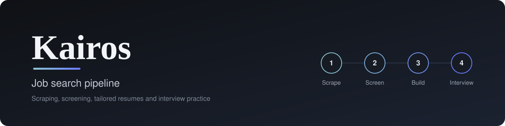
</p>

<p align="center">
  
  
  
  
  
  
  
</p>

# Kairos

I built Kairos to take the grind out of job hunting. It scrapes postings
from a bunch of job boards, has an LLM screen each one against my profile,
and writes a tailored resume and cover letter for the ones worth applying
to. It can also run a spoken mock interview for a job, or put together a
prep guide with company research.

The agents are [LangGraph](https://github.com/langchain-ai/langgraph) graphs
behind a local FastAPI server. On top of that there's an Electron desktop
app, an Expo phone app, a Chrome extension that fills in application forms,
and a CLI.

## Contents

- [Features](#features)
- [Screenshots](#screenshots)
- [How it works](#how-it-works)
- [Requirements](#requirements)
- [Setup guide](#setup-guide)
- [Configuration](#configuration)
- [Usage](#usage)
- [Building installers](#building-installers)
- [Project layout](#project-layout)
- [Supported job boards](#supported-job-boards)
- [Tech stack](#tech-stack)
- [License](#license)

## Features

- Scrapes Indeed, LinkedIn, Glassdoor, ZipRecruiter, Google Jobs, JobRight,
  Wellfound and others, removes duplicates across sites, and can run on a
  daily schedule.
- A screener agent marks each job yes, maybe or no based on your skills,
  experience level, keywords and company blacklist, and explains why.
- Writer agents produce a LaTeX resume per job. An ATS check scores it, and
  any weak sections get rewritten until it passes or stops improving.
- Cover letter generated alongside each resume. Both are compiled to PDF.
- Resume designer for picking, ordering and styling sections, with a live
  preview. You can also paste in your own LaTeX template.
- Voice mock interviews (behavioral, resume deep-dive, tech stack, or a
  general screen) with follow-up questions and a score for every answer.
  Speech runs locally with Whisper and Kokoro, or through free cloud voices.
- Prep guides with company research pulled from live web search (with
  sources), role fit, practice questions and answers, questions to ask, and
  study links.
- Chrome extension that fills application forms on any site using your
  profile and the resume/cover letter Kairos built for that job.
- Works with Ollama Cloud or Gemini, rotating through multiple API keys when
  one hits a rate limit. You can pick the provider per task, or build a
  resume with the Claude CLI on a Claude subscription.
- Phone app that works from any network through a Cloudflare tunnel.

## Screenshots

Overview page with pipeline stats, screener verdicts, applications per day
and jobs by board:

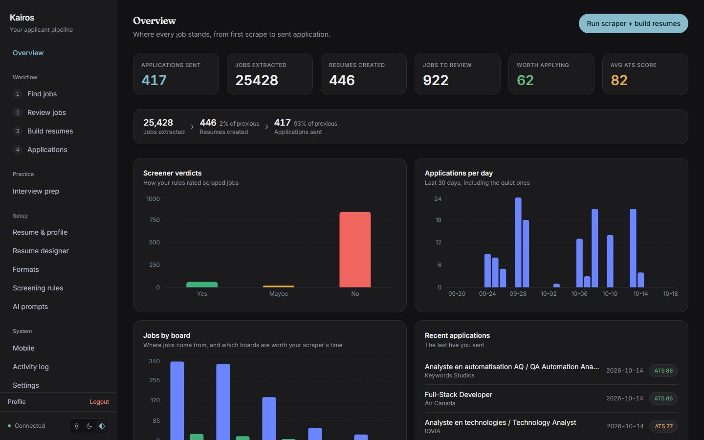

<table>
  <tr>
    <td width="50%">Review jobs<br>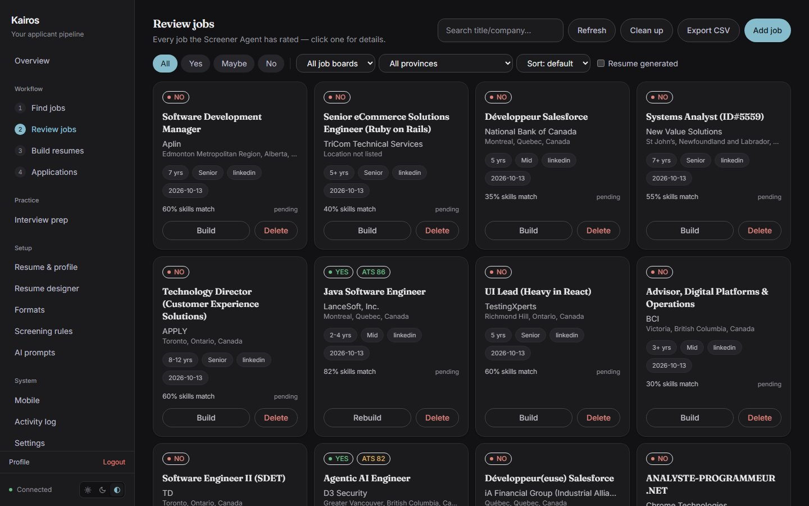</td>
    <td width="50%">Job detail with the generated resume<br>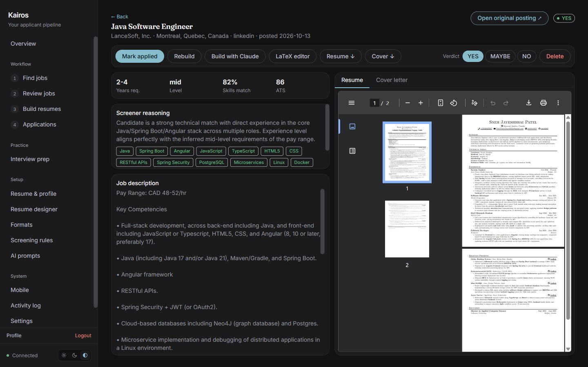</td>
  </tr>
  <tr>
    <td>Build resumes<br>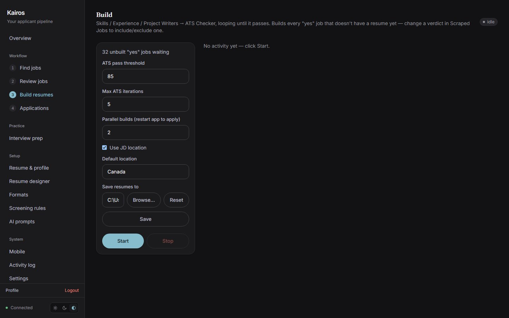</td>
    <td>Applications<br>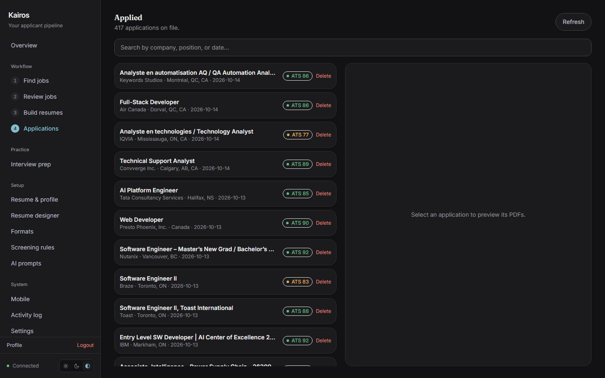</td>
  </tr>
  <tr>
    <td>Interview prep<br>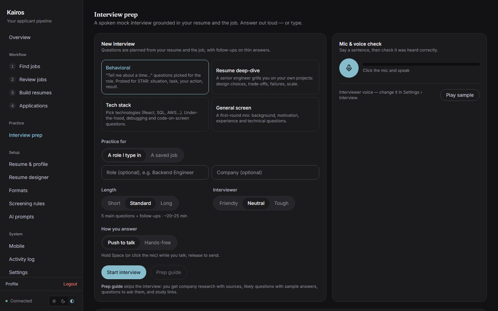</td>
    <td>Prep guide<br>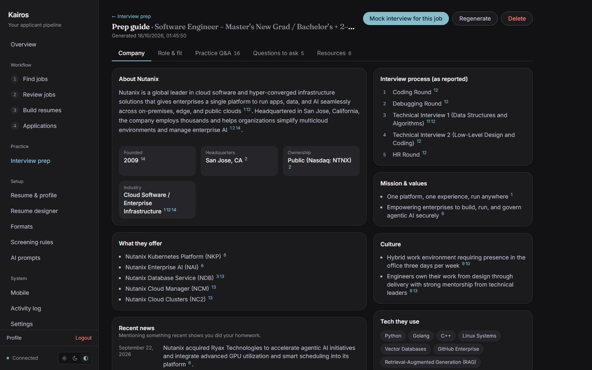</td>
  </tr>
  <tr>
    <td>Resume designer<br>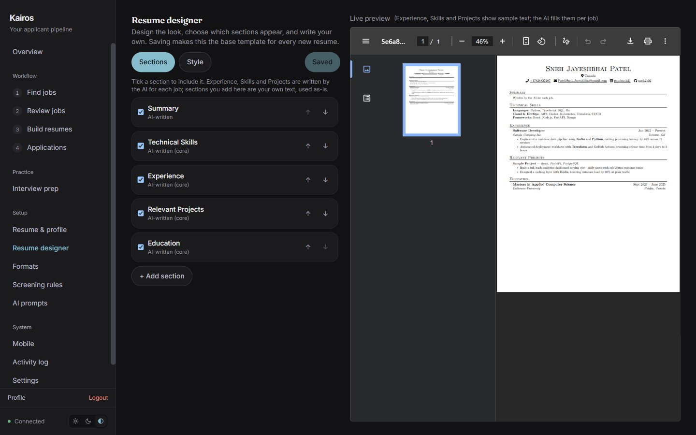</td>
    <td>Screening rules<br>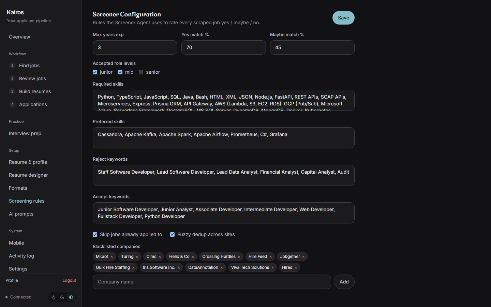</td>
  </tr>
</table>

## How it works

All the clients talk to the same backend, which runs the graphs and keeps
everything in SQLite. The CLI calls the graphs directly.

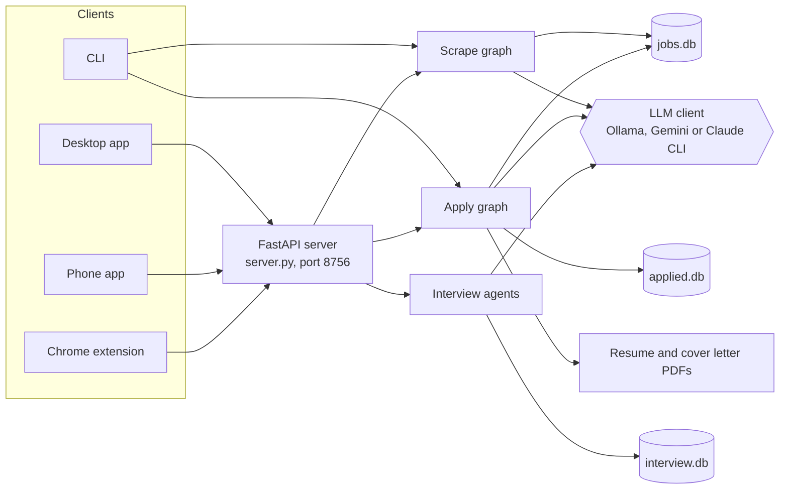

### Scrape graph

`graph/scrape_graph.py`. The bundled `jobspy` scraper pulls postings for
your search terms and sites, then the screener rates each one and saves it
to `jobs.db`.

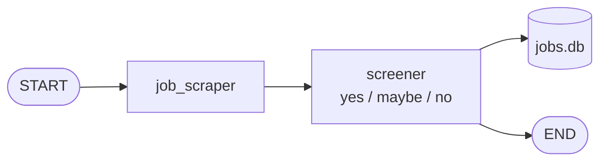

After that you go through the yes and maybe jobs (the Review jobs page, or
`main.py review`) and change any verdict you don't agree with.

### Apply graph

`graph/apply_graph.py`. For each yes job that doesn't have a resume yet, the
skills, experience and projects writers run in parallel. Then the resume
goes through an optimize and ATS check loop. If the check flags sections,
only those get rewritten. The loop stops when the score passes the
threshold, hits `max_ats_iterations`, or stops improving.

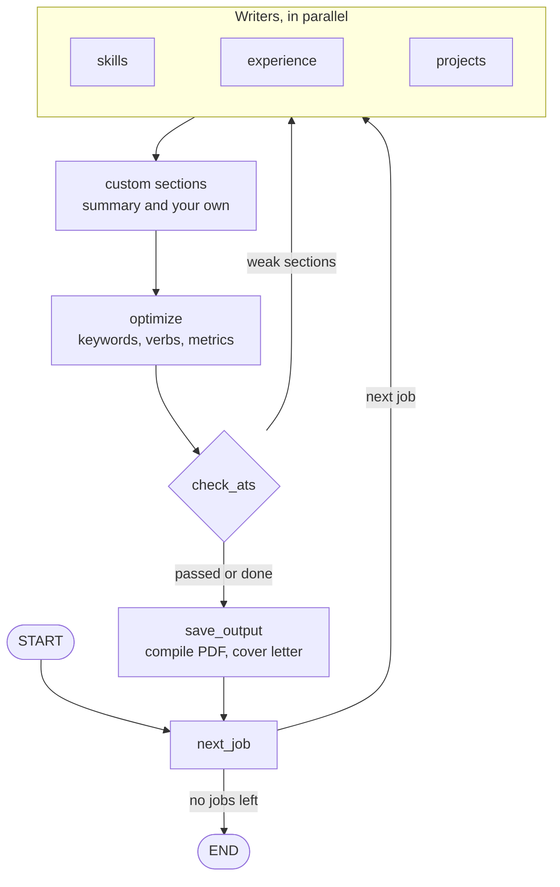

A few things that aren't obvious from the diagram:

- `save_output` keeps whichever draft scored highest, which isn't always the
  last one.
- If the LaTeX doesn't compile, the error goes back to the model to fix
  (`max_latex_fix_attempts` tries).
- Several jobs build at once (`pipeline.build_workers`, default 2). The
  queue is saved to `build_queue.json` so it survives a restart.
- "Build with Claude" on a job page writes the sections with the `claude`
  CLI instead of the API.

### Interview prep

`agents/interviewer.py`, `agents/prep_guide.py`, `agents/tech_bank.py` and
`tools/speech.py`.

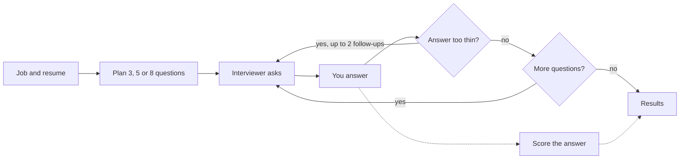

Questions are read out with Kokoro, Edge voices or the browser's built-in
speech, and your answers are transcribed with Whisper (locally or through
Groq). Each answer is scored separately and the score is never read out
during the interview. For prep guides, company facts only come from web
search results and each one cites its source, so the model can't fill gaps
from memory.

## Requirements

- Python 3.11+
- Node.js 18+ and npm
- An Ollama Cloud or Gemini API key (or both)
- A LaTeX engine: [Tectonic](https://tectonic-typesetting.github.io/)
  (easiest) or `pdflatex` from MiKTeX/TeX Live
- Playwright Chromium, used for Glassdoor and Google Jobs

Optional, depending on what you use:

| Feature | Needs |
|---|---|
| Mock interviews | A microphone. Whisper and Kokoro models download into `models/` the first time. A free [Groq](https://console.groq.com) key helps if local transcription is slow. |
| Build with Claude | The [`claude` CLI](https://claude.com/claude-code), logged in. |
| Phone app | Node.js 22.13+, [`cloudflared`](https://developers.cloudflare.com/cloudflare-one/connections/connect-networks/downloads/), and [Expo Go](https://expo.dev/go) on your phone. |

## Setup guide

The first five steps get you to a working pipeline. The rest are worth doing
before your first real build, since they decide how good the resumes and
screening are. Everything here can be changed later from the app.

- [1. Install](#1-install)
- [2. Start the app](#2-start-the-app)
- [3. AI provider and API keys](#3-ai-provider-and-api-keys)
- [4. Profile](#4-profile)
- [5. Resume, projects and work experience](#5-resume-projects-and-work-experience)
- [6. Screening rules](#6-screening-rules)
- [7. Scraper and schedule](#7-scraper-and-schedule)
- [8. Resume format and sections](#8-resume-format-and-sections)
- [9. AI prompts](#9-ai-prompts)
- [10. Build settings](#10-build-settings)
- [11. Interview voice (optional)](#11-interview-voice-optional)
- [12. Check it works](#12-check-it-works)

### 1. Install

These commands are for Windows. On macOS, use the commented lines or run
`setup-mac.command` (see [BUILD-MACOS.md](BUILD-MACOS.md)).

```bash
git clone https://github.com/sneh2102/Kairos.git
cd Kairos

python -m venv venv
venv\Scripts\activate              # macOS/Linux: source venv/bin/activate
pip install -r requirements.txt
playwright install chromium

# LaTeX engine for building the PDFs
winget install --id TectonicTypesetting.Tectonic     # macOS: brew install tectonic

cp .env.example .env

cd desktop
npm install
```

### 2. Start the app

```bash
cd desktop
npm start
```

Electron starts the backend on `127.0.0.1:8756`. On first launch you land on
the setup wizard, which walks through profile, resume material, model and
API key, scraper defaults and where resumes get saved. You can fill it in or
click "Skip for now". The steps below cover the same ground in more detail,
plus everything the wizard leaves out.

`config.json` gets created from `config.example.json` the first time the
backend starts. It's gitignored, so your data stays local.

### 3. AI provider and API keys

Kairos needs at least one LLM provider. Pick one in **Settings > Model > AI
provider**.

**Ollama Cloud**

1. Sign up at [ollama.com](https://ollama.com), go to Settings > API keys and
   create a key.
2. Paste it in **Settings > API Keys**, or put it in `.env`:

   ```
   OLLAMA_API_KEY_1=your-key
   OLLAMA_API_KEY_2=another-key   # optional, more keys = more headroom
   ```

   Keys are rotated automatically when one hits a rate limit.
3. In **Settings > Model**, set the **Screening model** and **Resume/ATS
   model** (the defaults are `gemma4:31b-cloud`). Screening runs on every
   scraped job, so a smaller, faster model is fine there. The resume model
   matters more.

**Google Gemini**

1. Create a key in [Google AI Studio](https://aistudio.google.com/apikey).
2. In **Settings > Model**, choose Google Gemini, paste the key into
   **Gemini API keys** (one per line if you have several) and click
   **Verify**.
3. Pick the **Gemini model**. Clear the box to see the list.

**Mixing providers.** Under **Provider per task** you can send each stage to
a different provider: job screener, experience, projects, skills, summary
and custom sections, cover letter, ATS checker/optimizer/LaTeX fixer, and
the mock interviewer. "Default" uses the provider chosen above. I run
screening on Ollama and resume writing on Gemini, for example, so neither
pool runs out.

**Other settings on the Model tab**

- **Context window**: raise it if long job descriptions get cut off.
- **Temperature (x100)**: 100 = 1.0. Lower it for more predictable writing.

**Optional keys**

- **GitHub token** (Settings > API Keys): only raises the rate limit for
  project import in step 5.
- **Claude CLI**: install [Claude Code](https://claude.com/claude-code) and
  log in. This enables **Build with Claude** on job pages, which uses your
  Claude subscription instead of an API key.

### 4. Profile

**Resume & profile > Profile.** The screener and every writer read this, so
fill in all of it:

| Field | Used for |
|---|---|
| Full name, Phone, Email, LinkedIn, GitHub, Location | Resume header, cover letter, extension autofill |
| Years of experience | Screener compares it against what each job asks for |
| Core stack | Main skills the writers lean on |
| Target job titles | Helps the screener judge whether a role fits |
| Not a fit for | Roles to always reject (for example "manager, sales, QA") |

### 5. Resume, projects and work experience

This is the material the writers build every resume from. They only use
what's here, so the more detail you give them, the better the output.

**Resume text** (Resume & profile > Resume text). Paste your full current
resume as plain text: contact info, education, skills and every experience
bullet. Formatting doesn't matter.

**Projects** (Resume & profile > Projects). One block per project, in this
format:

```
Project Name | React, FastAPI, PostgreSQL | https://github.com/you/project
- What you built and why
- A result with a number if you have one
- Another bullet
```

Write more projects than fit on one resume. The writer picks the most
relevant ones for each job. Set **Number of projects** and **Bullets per
project** at the top of the tab.

To skip typing, use **Import from GitHub**: enter your username, click
**List repos**, then **Generate & append** on each repo. The model reads the
repo and writes a project block for it.

**Work experience** (Resume & profile > Work experience). Add one entry per
role, in the order it should appear on the resume:

| Field | Meaning |
|---|---|
| Title, Company, Dates | Shown as-is on the resume |
| Domain | The kind of work, for example "fintech backend" or "data pipelines". Keeps generated bullets realistic for that role. |
| Total bullets | How many bullets this role gets on the resume |
| Real bullets | How many of those come from your actual resume text |
| Fabricated bullets | Extra bullets the writer invents to cover skills the job asks for that your resume doesn't show, kept believable for that role's domain. Set to 0 if you only want real experience. |

Use the arrows to reorder roles. Click **Save all** when you're done.

**Section order** (Resume & profile > Section order) sets the order
sections appear in. **Custom sections** is covered in step 8.

### 6. Screening rules

**Screening rules** in the sidebar. These decide which jobs come back as
yes, maybe or no.

| Setting | What it does |
|---|---|
| Max years exp | Jobs asking for more than this get marked down |
| Yes match % / Maybe match % | Skills match needed for yes and for maybe (defaults 70 and 45) |
| Accepted role levels | Junior, mid and/or senior |
| Required skills | Your main skills. The match % is measured against these. |
| Preferred skills | Nice to have. They raise the score but aren't required. |
| Reject keywords | Titles to always reject, for example "Staff, Lead, Principal" |
| Accept keywords | Titles to always consider, for example "Junior Developer, Web Developer" |
| Skip jobs already applied to | Don't screen jobs that are already in Applications |
| Fuzzy dedup across sites | Treat the same job posted on several boards as one |
| Blacklisted companies | Always rejected. Useful for staffing agencies and spam posters. |

Expect to tune this. After the first scrape, look at the yes and no jobs on
Review jobs. Change verdicts you disagree with, and adjust the rules if a
pattern shows up.

The instructions the screener follows are in AI prompts (step 9) under "Job
Screener".

### 7. Scraper and schedule

**Find jobs** in the sidebar.

- **Sites**: which boards to search.
- **Search terms**: one per line. Each term is a separate search, so use the
  titles you'd actually type, for example "software developer", "backend
  engineer".
- **Location** and **Country** (Country is for Indeed, for example `canada`
  or `usa`).
- **Hours old**: only fetch jobs posted within this window. 24 to 72 works
  well for a daily run.
- **Results wanted**: per search term, per site.
- **JobRight** and **Greenhouse** need you to log in. When those sites are
  selected, a **Connect** button appears. It opens a browser where you sign
  in once, and the session is saved.

To run it every day, go to **Settings > Scheduler**, turn it on and set a
time (24h, local). The app has to be running at that time.

### 8. Resume format and sections

**Formats** in the sidebar picks the LaTeX template. "Classic (Jake's
Resume)" is the default. Click **Add Format** to paste your own template.
Any macros the generated sections need are added automatically, so it still
compiles.

**Resume designer** lets you change the look without writing LaTeX:

- **Sections** tab: tick the sections to include, reorder them, and **Add
  section** for your own fixed text (certifications, awards, languages).
  Text you add here is used as-is on every resume.
- **Style** tab: font, text size, margins, spacing, heading style, accent
  color, header layout and bullet symbol.
- The preview on the right updates live. Click **Save** to make it the base
  template for new resumes.

For a section the AI should write per job, like a Summary, use **Resume &
profile > Custom sections**. Each one has a system prompt (the output format)
and a user prompt, and can use these placeholders: `{full_name}`, `{title}`,
`{company}`, `{description}`, `{existing_resume}`, `{ats_feedback}`. Custom
sections are written once per job, after the core sections, and aren't
rewritten by the ATS loop.

### 9. AI prompts

**AI prompts** in the sidebar. Every agent's
instructions can be edited here. The required output format is enforced in
code separately, so a bad edit can't break generation. **Reset to Default**
is always there if you want the original back.

| Prompt | What it controls |
|---|---|
| Job Screener | How jobs are judged against your profile and rules |
| Skills Section | How the skills section is chosen and grouped for each job |
| Experience Section | How experience bullets are written and tailored |
| Projects Section | Which projects are picked and how they're written up |
| Surgical Rewrite | How flagged sections are fixed after ATS feedback |
| Cover Letter | Tone, length and structure of the cover letter |
| LaTeX Fixer | How compile errors are repaired |
| ATS Checker | What the checker looks for when scoring a resume |
| Mock Interviewer (one per kind) | Persona and style for behavioral, resume, tech stack and general interviews |

The editor lists the placeholders each prompt can use, for example
`{title}`, `{company}`, `{description}`. The prompts most worth editing are
Experience Section (to match how you write) and Cover Letter (tone).

### 10. Build settings

**Build resumes** in the sidebar.

| Setting | Default | Notes |
|---|---|---|
| ATS pass threshold | 85 | Score a resume needs before it stops being rewritten |
| Max ATS iterations | 5 | Upper limit on rewrite rounds per job |
| Parallel builds | 2 | Jobs built at the same time. Raise it if you have several API keys. Needs a restart. |
| Use JD location | on | Puts the job's location on the resume instead of yours |
| Default location | | Used when the job doesn't list one |
| Save resumes to | Documents/Job-Hunter/Resumes | Where PDFs are written |

Higher thresholds and more iterations mean better scores but more API
calls per job.

### 11. Interview voice (optional)

Settings > Interview.

- **Speech to text**: **Local** runs Whisper on your machine (GPU if
  available, otherwise CPU). Choose a model size: `small.en` is a good
  default, `tiny.en` or `base.en` on slower machines. **Groq** uses their
  free hosted Whisper and needs a key. A Groq key also acts as a backup if
  local Whisper fails.
- **Text to speech**: **Kokoro** (local, about 90 MB download), **Edge**
  (free, online) or **Browser** (your OS voices). Pick a voice and speed,
  then use **Play sample** on the Interview prep page to check it.
- Models download into `models/` the first time you use them.

The interviewer's LLM follows Model > Provider per task > Mock interviewer.

### 12. Check it works

1. **Find jobs**: run a scrape with one search term and a small Results
   wanted value. Jobs should appear on **Review jobs** with verdicts.
2. Open a yes job and click **Rebuild** (or use **Build resumes**). Watch
   the progress and the **Activity log**.
3. When it finishes, the resume and cover letter PDFs show on the job page.
4. If something fails, check **Activity log** first. The usual causes are a
   missing or rate-limited API key, or Tectonic not being on your `PATH`.

The phone app and Chrome extension have their own setup, in
[Mobile app](#mobile-app) and [Chrome extension](#chrome-extension).

## Configuration

Everything in the setup guide is saved to a few local files. You normally
won't touch them, but they're handy for backups or moving to another
machine. In an installed build they live in the app data folder instead of
the project folder.

`config.json` (gitignored, created from [`config.example.json`](config.example.json)):

| Section | What it controls |
|---|---|
| `scraper` | Sites, location, search terms, number of results |
| `profile` | Name, contact info, experience, roles you're not a fit for |
| `screener` | Thresholds, required/preferred skills, keywords, blacklisted companies |
| `model` | Provider, models per stage, per-task provider, API keys |
| `pipeline` | ATS threshold and iteration limits, `build_workers`, file names, LaTeX template |
| `prompts` | Every LLM prompt. Also editable on the AI prompts page. |
| `experience_roles` | Work experience entries and bullet counts |
| `custom_sections` | Extra resume sections beyond skills, experience and projects |
| `section_order` | Order of sections on the resume |
| `interview` | Speech engines, Whisper model, interviewer voice |
| `scheduler` | Time for the daily scrape |

Other files:

- `resume.txt` and `projects.txt`: the resume text and projects from step 5.
- `.env`: Ollama keys, `OUTPUT_DIR`, and `TUNNEL_TOKEN` for the phone app.
- `jobs.db`, `applied.db`, `interview.db`: scraped jobs, applications, and
  interview sessions and prep guides.

## Usage

### Desktop app

```bash
cd desktop
npm start
```

This starts Vite and Electron, and Electron starts `server.py`. The sidebar
goes in the order you'd normally work:

1. Find jobs: run the scraper, or use "Run scraper + build resumes" on the
   Overview page.
2. Review jobs: check the verdicts and change any you disagree with.
3. Build resumes: builds every yes job that doesn't have one yet.
4. Applications: download the PDFs and mark jobs as applied.
5. Interview prep: run a mock interview or make a prep guide for a job.

### Mobile app

Set up the desktop app first.

One-time setup:

1. `cd mobile && npm install`
2. Install cloudflared (`winget install --id Cloudflare.cloudflared`) and
   copy `cloudflared.exe` into `desktop/build-resources/cloudflared/`, or
   just keep it on your `PATH`.
3. Generate a token with
   `python -c "import secrets; print(secrets.token_urlsafe(32))"` and put the
   same value in `.env` as `TUNNEL_TOKEN` and in `mobile/config.ts` as
   `API_TOKEN`. Requests through the tunnel without a matching token are
   rejected.
4. Install Expo Go on your phone.

Then each time: open the Mobile page in the desktop app, click Start mobile,
and scan the QR code with Expo Go. The first start takes 20 to 30 seconds.
Stop (or closing the app) shuts the tunnels down.

Start mobile opens two Cloudflare quick tunnels, one for the backend and one
for the Metro bundler. It writes the backend URL into `mobile/config.ts` and
passes the Metro URL to Expo through `EXPO_PACKAGER_PROXY_URL`. You don't
need a Cloudflare account. I avoided Expo's own `--tunnel` because it was
unreliable and now wants an ngrok account.

### Chrome extension

The extension fills in job application forms on any site. Written answers
come from Claude, Gemini or Ollama. If Kairos is running, it also uses the
resume and cover letter built for that job.

1. Go to `chrome://extensions`, turn on Developer mode, click Load unpacked
   and pick the `extension/` folder.
2. In the extension's options, choose a provider and key, check the Kairos
   URL (default `http://127.0.0.1:8756`), and fill in your profile. If you
   put a `profile.local.json` in `extension/` (it's gitignored), it gets
   loaded into the settings on install.
3. On an application page, click the extension icon or press Alt+Shift+F.

It only uses what's in your profile and resume. Anything it can't answer
from those is left blank, and it says no to talent pool and marketing
consent boxes.

### CLI

```bash
python main.py scrape   # scrape and screen new jobs into jobs.db
python main.py review   # go through yes/maybe jobs and change verdicts
python main.py apply    # build resumes for every unbuilt yes job
```

To run only the API:

```bash
uvicorn server:app --port 8756
```

## Building installers

```bash
cd desktop
npm run dist:win     # Windows installer (NSIS)
npm run dist:mac     # macOS, see BUILD-MACOS.md
```

This builds the React app, packages `server.py` into an executable with
PyInstaller (`server.spec`), and bundles both with Tectonic, a portable
Chromium and the resume icons using electron-builder. The GitHub workflow in
`.github/workflows/build.yml` does the same thing. Installed builds keep
config, resumes, databases and models in the user's app data folder.

## Project layout

```
agents/       Agent nodes: screener, section writers, ATS checker, optimizer,
              LaTeX fixer, interviewer, prep guide, tech question bank, GitHub import
graph/        scrape_graph and apply_graph, plus the shared state
jobspy/       Bundled job scraper (my fork, with JobRight and Wellfound added)
llm/          Ollama, Gemini and Claude CLI clients, key rotation, web search
db/           SQLite access for jobs, applications, interviews and prep guides
tools/        LaTeX build, templates, designer, cover letters, speech
desktop/      Electron + React + Tailwind app; electron/main.cjs also runs the mobile bridge
mobile/       Expo / React Native app
extension/    Chrome extension (Manifest V3)
server.py     FastAPI backend
main.py       CLI (scrape / review / apply)
config.py     Loads config.json and .env; config.example.json is the template
```

## Supported job boards

Indeed, LinkedIn, Glassdoor, ZipRecruiter, Google Jobs, JobRight, Wellfound,
Greenhouse, HiringCafe, Naukri, Bayt, BDJobs.

## Tech stack

- Agents: Python, LangGraph
- LLMs: Ollama Cloud, Google Gemini, Claude CLI
- Backend: FastAPI, Uvicorn, SQLite, Playwright
- Desktop: Electron, React, TypeScript, Vite, Tailwind CSS
- Mobile: React Native, Expo, Cloudflare Tunnel
- Speech: faster-whisper, Groq, Kokoro, Edge TTS
- Documents: LaTeX (Tectonic or pdflatex), ReportLab

## License

MIT, see [LICENSE](LICENSE).
